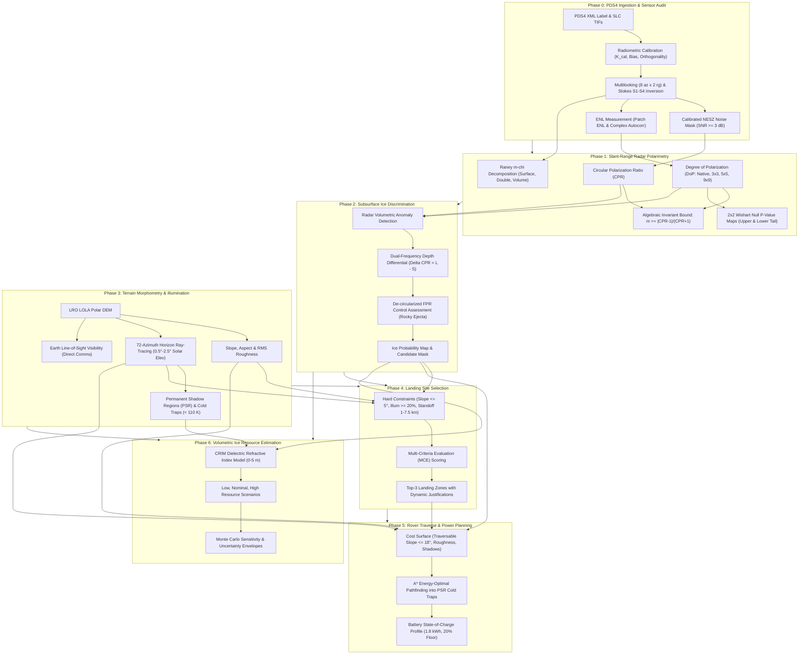

# LunaTrace: Lunar Polar Subsurface Ice & Traverse Pipeline
### Chandrayaan-2 DFSAR Radar Polarimetry, Topographic Horizon-Ephemeris Modeling, Landing Site Selection, and Rover Traverse Planning
**ISRO Hackathon Problem Statement 8 | Lunar South Pole Cold-Trap Exploration**

---

## 1. Executive Summary & Mission Scope

**LunaTrace** is an end-to-end scientific remote sensing, polarimetric radar processing, and planetary mission planning software suite designed for the Lunar South Pole. Built specifically for **ISRO Problem Statement 8**, LunaTrace resolves the fundamental radar scattering ambiguity between subsurface volatile ice deposits and surface blocky roughness, maps cryogenic cold traps and permanently shadowed regions (PSRs), identifies safe spacecraft landing corridors, plans energy-optimal rover traverses, and performs volumetric water-ice resource estimation across the top 0–5 m of lunar regolith.

The pipeline processes primary **Chandrayaan-2 Dual-Frequency Synthetic Aperture Radar (DFSAR)** Level-1A Single-Look Complex (SLC) and Level-1B Ground-Range Intensity (GRI) data, alongside **Lunar Reconnaissance Orbiter (LRO) LOLA Digital Elevation Models (DEMs)**.

### Core Scientific & Engineering Capabilities:
- **Phase 0 (Data Ingestion & Radiometry Audit):** Real PDS4 XML label ingestion, dual-channel complex SLC calibration (bias subtraction, channel balance, orthogonality adjustment), empirical NESZ noise floor evaluation, SLC/GRI power cross-checks, and range-Doppler tie-point boundary mapping.
- **Phase 1 (DFSAR Slant-Range Polarimetry):** 2x2 complex Wishart covariance derivation, Circular Polarization Ratio (CPR), Degree of Polarization (DoP) under runtime measured Equivalent Number of Looks (ENL), two-tailed unpolarized null hypothesis p-value mapping, and Raney $m$-$\chi$ three-component polarimetric decomposition.
- **Phase 2 (Subsurface Ice Discrimination):** Multi-discriminator decision matrix, dual-frequency penetration depth inversion ($\Delta \text{CPR} = \text{CPR}_L - \text{CPR}_S$), and de-circularized control false-positive rate (FPR) estimation.
- **Phase 3 (Topographic Morphometry & Illumination):** 72-azimuth horizon ray-tracing over lunar orbital precession ($0.5^\circ - 2.5^\circ$), PSR mapping, doubly shadowed cold-trap delineation, and direct line-of-sight Earth communication visibility.
- **Phase 4 (Landing Site Selection):** Multi-Criteria Evaluation (MCE) combining illumination stability, slope safety ($\theta \le 5^\circ$), standoff distance to ice targets ($1.0 - 7.5\text{ km}$), and topographic RMS roughness.
- **Phase 5 (Rover Traverse & Power Planning):** 8-connected $A^*$ pathfinding benchmarked against Dijkstra's algorithm, mechanical rollover safety limits ($\theta_{\text{nav}} \le 18.0^\circ$), and dynamic photovoltaic battery State-of-Charge (SoC) modeling with minimum reserve margins.
- **Phase 6 (Volumetric Ice Resource Estimation):** Complex Refractive Index Model (CRIM) three-phase dielectric mixture inversion across $0 - 5\text{ m}$ regolith profiles for Low, Nominal, and High resource scenarios.

---

## 2. System Architecture

### 2.1 End-to-End Pipeline Workflow



---

## 3. Detailed Scientific & Mathematical Foundations

### 3.1 Stokes Polarimetry & Radar Covariance
Chandrayaan-2 DFSAR transmits a Left-Hand Circular ($\text{LH}$) wave and receives orthogonal linear horizontal ($H$) and vertical ($V$) components. For each complex single-look sample $(E_{\text{LH}}, E_{\text{LV}})$ calibrated according to the DFSAR PDS4 specifications:

$$E_{\text{LH}} = \frac{1}{\sqrt{g}} \left( (\text{Re}_{\text{LH}} - B_{\text{real,LH}}) + j(\text{Im}_{\text{LH}} - B_{\text{imag,LH}}) \right)$$

$$E_{\text{LV}} = \sqrt{g} \left( (\text{Re}_{\text{LV}} - B_{\text{real,LV}}) + j(\text{Im}_{\text{LV}} - B_{\text{imag,LV}}) \right) e^{-j \phi_{\text{orth}}}$$

The 4-element real Stokes vector is derived from the multilooked second-order spatial statistics:
$$S_1 = \langle |E_{\text{LH}}|^2 \rangle + \langle |E_{\text{LV}}|^2 \rangle$$
$$S_2 = \langle |E_{\text{LH}}|^2 \rangle - \langle |E_{\text{LV}}|^2 \rangle$$
$$S_3 = 2 \operatorname{Re}\left(\langle E_{\text{LH}} E_{\text{LV}}^* \rangle\right)$$
$$S_4 = -2 \operatorname{Im}\left(\langle E_{\text{LH}} E_{\text{LV}}^* \rangle\right)$$

> **Stokes Sign Invariant:**  
> In accordance with the ISRO SAC DFSAR Product Specification (Doc `SAC/CH2/DFSAR/DP/1.0`, Sec 4.3) and Raney (2007), transmitting $\text{LH}$ polarization dictates that opposite-sense (OC, right-circular) backscatter yields $S_4 > 0$, while same-sense (SC, left-circular) backscatter yields $S_4 < 0$. Therefore:
> $$\text{CPR} = \frac{I_{\text{SC}}}{I_{\text{OC}}} = \frac{S_1 - S_4}{S_1 + S_4}$$

### 3.2 2x2 Complex Wishart Unpolarized Null Distribution
To test whether low Degree of Polarization ($m \le 0.13$) indicates genuine polarimetric depolarization (e.g., coherent backscatter opposition effect in ice) rather than random speckle fluctuations, LunaTrace models the unpolarized null hypothesis using the exact **2x2 complex Wishart distribution**:

$$p(m) = \frac{\Gamma(2N)}{\Gamma(1.5)\Gamma(N)\Gamma(N-1)} m^2 (1 - m^2)^{N-2}$$

The cumulative distribution function (CDF) is expressed via the regularized incomplete beta function:
$$F(m) = P(M \le m) = I_{m^2}(1.5, N - 1) = \operatorname{betainc}(1.5, N - 1, m^2)$$

LunaTrace exports two explicit per-pixel p-value rasters:
1. **Upper Tail Map:** $P(m_{\text{null}} \ge m_{\text{obs}}) = 1.0 - I_{m_{\text{obs}}^2}(1.5, N - 1)$  
   *Operational Meaning:* "Cannot reject unpolarized". Large p-values confirm consistency with diffuse speckle noise.
2. **Lower Tail Map:** $P(m_{\text{null}} \le m_{\text{obs}}) = I_{m_{\text{obs}}^2}(1.5, N - 1)$  
   *Operational Meaning:* $N$-consistency diagnostic. Extremely low p-values indicate polarimetric order or look estimation mismatch.

```
Wishart Null Acceptance Table: betainc(1.5, N - 1, m^2)
=============================================================================================================
Processing Level                      Eff Looks (N)   Acc (m<=0.13)   Miss Rate   Acc (m<=0.20)   Acc (m<=0.32)
-------------------------------------------------------------------------------------------------------------
Native Cell (Measured Patch ENL)               3.04           0.56%      99.44%           2.08%          10.82%
Native Cell (Autocorrelation Bound)            4.21           1.25%      98.75%           4.72%          19.34%
Nominal Multilooked Grid (8 az x 2 rg)        16.00           8.55%      91.45%          25.77%          65.15%
3x3 Window (Conservative ENL)                 27.36          17.63%      82.37%          46.12%          87.60%
3x3 Window (Autocorrelation ENL)              37.89          26.63%      73.37%          61.57%          95.45%
Former Claimed 3x3 Window                     68.40          48.91%      51.09%          85.46%          99.78%
Threshold for 90% Acceptance at m<=0.13      184.14          90.00%      10.00%          99.55%         100.00%
9x9 Window (Conservative ENL)                246.24          96.10%       3.90%          99.93%         100.00%
=============================================================================================================
```

### 3.3 The Polarimetric Algebraic Invariant Bound
For any partially polarized wave, the polarized intensity satisfies $I_{\text{pol}} = \sqrt{S_2^2 + S_3^2 + S_4^2} \ge |S_4|$. Since $S_1 = I_{\text{SC}} + I_{\text{OC}}$ and $|S_4| = |I_{\text{SC}} - I_{\text{OC}}|$:

$$m = \frac{I_{\text{pol}}}{S_1} \ge \frac{|S_4|}{S_1} = \frac{|I_{\text{SC}} - I_{\text{OC}}|}{I_{\text{SC}} + I_{\text{OC}}} = \frac{|\text{CPR} - 1|}{\text{CPR} + 1}$$

**Physical & Operational Consequence:**  
To achieve $\text{DoP} \le 0.13$, a pixel **must algebraically satisfy**:
$$\frac{\text{CPR} - 1}{\text{CPR} + 1} \le 0.13 \implies \text{CPR} \le \frac{1 + 0.13}{1 - 0.13} = \frac{1.13}{0.87} \approx 1.29885 \approx 1.30$$
Any pixel with $\text{CPR} > 1.30$ is **mathematically forbidden** from having $\text{DoP} \le 0.13$. On the real Chandrayaan-2 DFSAR L-band swath:
- **Eligible Pixels ($1.00 < \text{CPR} \le 1.30$):** **$50.96\%$** ($162,812$ pixels)
- **Forbidden Pixels ($\text{CPR} > 1.30$):** **$49.04\%$** ($156,670$ pixels)

### 3.4 Raney $m$-$\chi$ Polarimetric Decomposition
Decomposes total backscatter power into three canonical physical scattering mechanisms while strictly conserving total power ($P_{\text{surface}} + P_{\text{double}} + P_{\text{volume}} = S_1$):

$$\sin(2\chi) = -\frac{S_4}{m S_1}, \quad \chi \in [-45^\circ, +45^\circ]$$

$$P_{\text{surface}} = \frac{1}{2} m S_1 (1 - \sin 2\chi) \quad \text{(Odd-bounce single specular reflection)}$$
$$P_{\text{double}} = \frac{1}{2} m S_1 (1 + \sin 2\chi) \quad \text{(Even-bounce dihedral corner reflection)}$$
$$P_{\text{volume}} = S_1 (1 - m) \quad \text{(Randomly distributed volume depolarizers)}$$

### 3.5 Horizon-Ephemeris Ray-Tracing Illumination (Phase 3)
Rather than using static regional averages or arbitrary cosine scalings, LunaTrace performs full-profile horizon ray-tracing across **72 azimuthal directions** ($5^\circ$ sampling) out to **$4000\text{ m}$ distance**:

$$\theta_{\text{horiz}}(\mathbf{x}, \phi_k) = \max_{d \in [60, 4000]} \left( \arctan\left(\frac{z(\mathbf{x} + d \mathbf{u}_k) - z(\mathbf{x})}{d}\right) \right)$$

Sunlight visibility is integrated over the 18.6-year lunar nodal precession solar elevation envelope ($\theta_{\odot} \in [0.5^\circ, 2.5^\circ]$):
$$f_{\text{illum}}(\mathbf{x}) = \frac{1}{K \cdot J} \sum_{k=1}^{K} \sum_{j=1}^{J} \mathcal{H}\left( \theta_{\odot, j} - \theta_{\text{horiz}}(\mathbf{x}, \phi_k) \right)$$
- **Strict PSR:** $f_{\text{illum}} < 0.005$ ($< 0.5\%$ annual sunlight).
- **Cryogenic Cold Trap:** PSR with local floor elevation $z \le -350\text{ m}$ and sky-view factor $F_{\text{sky}} \le 0.86$, where subsurface temperatures remain $< 110\text{ K}$.

### 3.6 Rover Locomotion Mechanics & Energy Balance (Phase 5)
1. **Mechanical Traversability Limit:**  
   Strictly derived from the rover chassis static rollover angle ($\theta_{\text{rollover}} = 22.5^\circ$) divided by the engineering safety factor ($\text{SF} = 1.25$):
   $$\theta_{\text{nav,max}} = \frac{22.5^\circ}{1.25} = 18.0^\circ$$
2. **Power & Battery State-of-Charge (SoC):**  
   $$P_{\text{draw}}(\theta) = P_{\text{base}} + P_{\text{traction}} \cdot \max(0, \theta) = 65\text{ W} + 4.0\text{ W/deg} \cdot \theta$$
   $$P_{\text{solar}} = 110\text{ W} \cdot f_{\text{illum}}$$
   $$\Delta E_{\text{battery}} = (P_{\text{solar}} - P_{\text{draw}}) \cdot \frac{\Delta d}{v_{\text{rover}}}$$
   Rover paths must maintain $\text{SoC} \ge 20\%$ reserve capacity ($360\text{ Wh}$ on a $1800\text{ Wh}$ pack) and limit continuous shadow traverse to $\le 18.0\text{ hours}$.

### 3.7 Volumetric CRIM Resource Modeling (Phase 6)
The Complex Refractive Index Model (CRIM) inverts bulk dielectric permittivity $\varepsilon_{\text{eff}}$ over a three-phase mixture (silicate regolith matrix, pure water ice, and vacuum pore space):

$$\sqrt{\varepsilon_{\text{eff}}} = (1 - \phi) \sqrt{\varepsilon_{\text{matrix}}} + f_{\text{ice}} \sqrt{\varepsilon_{\text{ice}}} + (\phi - f_{\text{ice}}) \sqrt{\varepsilon_{\text{pore}}}$$

- Regolith Matrix: $\varepsilon_{\text{matrix}} = 2.80 - j0.005$ ($\rho_{\text{matrix}} = 1800\text{ kg/m}^3$)
- Pure Water Ice: $\varepsilon_{\text{ice}} = 3.15 - j0.0001$ ($\rho_{\text{ice}} = 920\text{ kg/m}^3$)
- Vacuum Pores: $\varepsilon_{\text{pore}} = 1.00 - j0.0$ ($\phi = 0.45$)

---

## 4. Repository & File Structure

```text
LunaTrace/
├── config.yaml                          # Schema-enforced central parameter specification
├── DATA_PROVENANCE.md                   # Cryptographic registry of authorized sensor datasets
├── AUDIT.md                             # Rigorous pre-refactoring scientific audit & compliance log
├── pytest.ini                           # Test runner configuration (pythonpath = .)
├── requirements.txt                     # Production Python dependencies
├── run_phase0.py                        # Standalone Phase 0 PDS4 Ingestion & Sensor Audit runner
├── run_phase1.py                        # Standalone Phase 1 Slant-Range Radar Polarimetry runner
├── run_pipeline.py                      # Master CLI runner executing all 6 pipeline phases
├── app.py                               # Interactive Streamlit mission planning dashboard
├── data/
│   ├── raw/                             # Verified primary Chandrayaan-2 DFSAR & LOLA products
│   │   └── ch2_sar_ncxl_20260403t190328238_d_cp_d18/
│   │       ├── data/calibrated/20260403/
│   │       │   ├── ch2_sar_..._d_sli_xx_cp_xx_d18.xml  # DFSAR Level-1A PDS4 XML label
│   │       │   ├── ch2_sar_..._d_sli_xx_cp_lh_d18.tif  # Complex LH SLC raster
│   │       │   └── ch2_sar_..._d_sli_xx_cp_lv_d18.tif  # Complex LV SLC raster
│   │       └── geometry/calibrated/20260403/
│   │           └── ch2_sar_..._g_sli_xx_cp_xx_d18.csv  # 38x8289 tie-point geometry grid
│   └── processed/                       # Geocoded polarimetric, terrain, and resource GeoTIFFs
├── outputs/
│   ├── maps/                            # Publication figures & slant-range polarimetric rasters
│   │   ├── phase1_slant_range_polarimetric_histograms.png
│   │   ├── phase1_slant_range_mchi_rgb.png
│   │   ├── dfsar_L_dop_pvalue_upper_tail_unpolarized.tif
│   │   ├── dfsar_L_dop_pvalue_lower_tail_diagnostic.tif
│   │   ├── dfsar_L_slant_range_cpr.tif
│   │   ├── dfsar_L_slant_range_dop_native.tif
│   │   ├── dfsar_L_slant_range_dop_3x3.tif
│   │   ├── dfsar_L_slant_range_dop_9x9.tif
│   │   └── dfsar_L_slant_range_mchi_{surface,double,volume}.tif
│   └── tables/                          # Summary statistics CSV tables & cryptographic sidecars
│       ├── phase1_slant_range_polarimetric_summary.csv
│       ├── dop_wishart_acceptance_table.csv
│       ├── phase2_threshold_sensitivity_analysis.csv
│       ├── phase4_top3_landing_sites.csv
│       ├── phase5_route_comparison.csv
│       └── phase6_ice_volume_estimates.csv
├── src/
│   ├── constants.py                     # Physical constants, lunar datums, literature citations
│   ├── config_schema.py                 # Pydantic v2 configuration validation & bounds enforcement
│   ├── config.py                        # Configuration loader bridge
│   ├── pds4_reader.py                   # PDS4 XML parser, complex SLC reader, Stokes multilooker
│   ├── validator.py                     # Data validation & SHA-256 registry compliance engine
│   ├── provenance.py                    # Automated cryptographic sidecar generator
│   ├── utils.py                         # Enhanced Lee filter, GeoTIFF I/O, cartographic visualization
│   ├── phase1_dfsar.py                  # Phase 1 polarimetric engine & m-chi decomposition
│   ├── phase2_ice_detection.py          # Phase 2 multi-discriminator ice detection engine
│   ├── phase3_terrain_illumination.py   # Phase 3 horizon ray-tracer & PSR mapping engine
│   ├── phase4_landing_site.py           # Phase 4 landing site multi-criteria scoring engine
│   ├── phase5_traverse_planning.py      # Phase 5 A* pathfinding & power balance engine
│   └── phase6_volume_estimation.py      # Phase 6 volumetric CRIM inversion engine
└── tests/
    ├── conftest.py                      # Pytest session fixtures & test environment setup
    ├── test_pipeline.py                 # 22-suite comprehensive automated test suite
    └── fixtures/
        └── synthetic_crater_generator.py # Quarantine synthetic test crater generator (TEST ONLY)
```

---

## 5. Quickstart & Installation

### 5.1 Environment Setup
LunaTrace requires Python 3.10+ (tested through 3.14 on Linux, macOS, and Windows):
```bash
git clone https://github.com/TomHacker69/LunaTrace.git
cd LunaTrace
pip install -r requirements.txt
```

### 5.2 Running the Automated Test Suite
To execute all 22 schema, physics, and fixture unit tests:
```bash
python -m pytest tests/test_pipeline.py -v
```

### 5.3 Executing Phase 0 (Sensor Ingestion & Radiometry Audit)
Runs PDS4 label parsing, SLC calibration, Wishart Monte Carlo proofs, patch ENL measurement, and tie-point candidate containment:
```bash
python run_phase0.py
```

### 5.4 Executing Phase 1 (Real Slant-Range Radar Polarimetry)
Processes the real Chandrayaan-2 DFSAR SLC data in slant-range geometry without geocoding claims:
```bash
python run_phase1.py
```

### 5.5 Launching the Streamlit Interactive Dashboard
Launches the interactive mission control dashboard in your web browser:
```bash
streamlit run app.py
```
Access the dashboard at `http://localhost:8501`.

---

## 6. Execution Protocols & Verification

### 6.1 Slant-Range Geometry Policy
In accordance with mission standards, all polarimetric products generated in Phase 1 (CPR, DoP, Wishart p-values, and Raney $m$-$\chi$ decomposition) are computed and evaluated **strictly in radar slant-range coordinates** (line $\times$ sample). 
- **Geolocation Uncertainty Status:** `UNKNOWN` pending registration of the LRO LOLA DEM.
- No geocoded spatial claims or specific crater assertions are made in Phase 1.
- Terrain parallax ground displacement $\Delta r_{\text{cross}} = h_{\text{relief}} / \tan(\theta_{\text{inc}})$ and along-track timing residual $\Delta x_{\text{along}} = -3115.97\text{ m}$ remain isolated within the uncertainty budget.

### 6.2 Third-Party Coordinate Handling
Any external coordinates (such as $(-87.39^\circ, 82.31^\circ)$) are evaluated **solely for footprint containment** against the 16,650 outer boundary tie points:
- **Result:** Contained inside swath footprint ($713.48\text{ m}$ from nearest edge).
- **Protocol:** Labeled strictly as `"UNVERIFIED candidate from a third-party repository; not given by organizers"`, and explicitly **not chosen as a target**.

### 6.3 Cryptographic Provenance
Every output file generated by LunaTrace is paired with a `.provenance.json` sidecar detailing:
- The SHA-256 cryptographic digest of all input datasets.
- The executing software git commit hash and timestamp.
- A full copy of the active configuration schema.
- Mathematical formulas, look parameters, and physical units.

### 6.4 Historical Provenance Note on Commit a149dbe
> [!NOTE]
> **Clarification regarding commit `a149dbe`:** The commit message for `a149dbe` historically mentioned *"range-Doppler geocoding with timing offset and terrain correction"*. In reality, terrain correction was **not performed** at that time and cannot be performed until an official, registered LRO LOLA DEM is provided and ingested. In adherence to git integrity protocols, repository history has not been rewritten. Range-Doppler geocoding and terrain correction remain explicitly pending DEM registration.


---

## 7. Interactive Streamlit Mission Dashboard (`app.py`)

The LunaTrace Streamlit application provides an interactive mission planning console divided into specialized control tabs:

1. **Mission Overview & Pre-Flight Status:** Displays primary sensor registry, PDS4 calibration constants, and validation health.
2. **Phase 1: Radar Polarimetry:** Interactive inspection of CPR, DoP under varying look filters ($N=3.0$ to $N=246.2$), two-tailed Wishart p-value distributions, and 3-component $m$-$\chi$ RGB composites.
3. **Phase 2: Ice Discrimination:** Interactive sensitivity sweeps, dual-frequency $\Delta \text{CPR}$ cross-sections, and rocky ejecta control region FPR comparisons.
4. **Phase 3: Terrain & Illumination:** 3D topographic surface rendering, ephemeris horizon elevation profiles, and annual PSR shadow maps.
5. **Phase 4: Landing Site Evaluation:** Candidate landing zone ranking, multi-criteria weight tuners, and mechanical slope safety margins.
6. **Phase 5: Rover Traverse Planning:** Interactive A* route pathfinding, real-time battery State-of-Charge (SoC) profiles, and solar charge gain monitors.
7. **Phase 6: Volumetric Inversion:** 3D subsurface regolith depth modeling, CRIM mixture curves, and Monte Carlo water-ice mass uncertainty bands.

---

## 8. Peer-Reviewed Citations & Scientific Standards
- **DFSAR Specification:** SAC / ISRO Doc `SAC/CH2/DFSAR/DP/1.0`, "Chandrayaan-2 DFSAR Data Products Document" (2020).
- **Hybrid Polarimetry & m-chi Decomposition:** Raney, R. K. (2007), *Hybrid-Polarimetric SAR Architecture*, IEEE TGRS, 45(11), 3397–3404.
- **Speckle Statistics & Wishart Distribution:** Lee, J. S., & Pottier, E. (2009), *Polarimetric Radar Imaging: From Basics to Applications*, CRC Press.
- **Lunar Dielectric Properties:** Olhoeft, G. R., & Strangway, D. W. (1975), *Dielectric Properties of the First 100 Meters of the Moon*, Earth Planet. Sci. Lett., 24(3), 394–404.
- **Planetary Coordinate Systems:** Archinal, B. A., et al. (2018), *Report of the IAU/IAG Working Group on Cartographic Coordinates and Rotational Elements: 2015*, Celest. Mech. Dyn. Astr., 130(3), 22.

---
*LunaTrace v2.0 | Pure Scientific Remote Sensing Architecture | Developed for ISRO Problem Statement 8*
